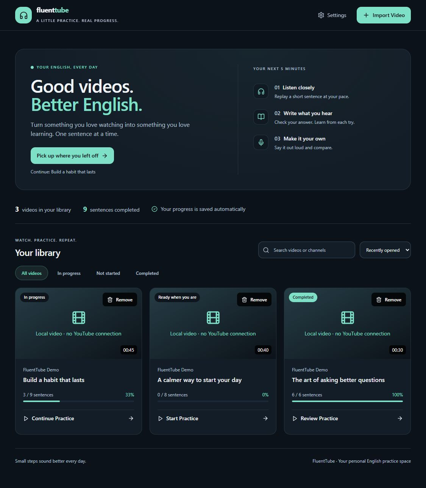
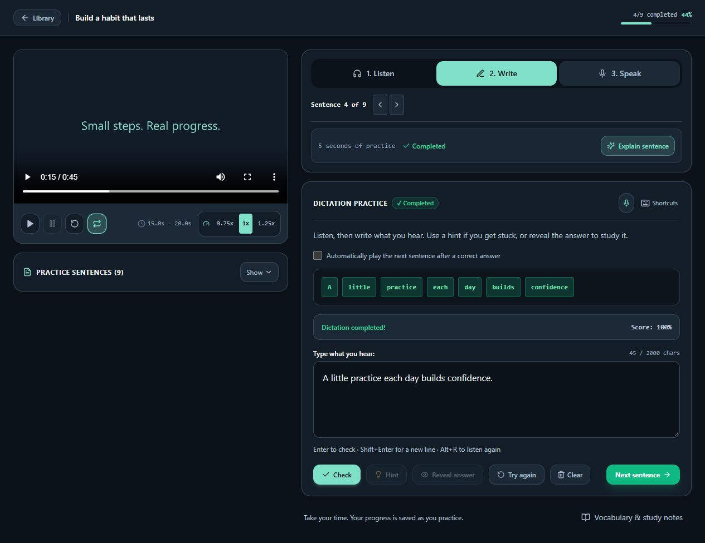
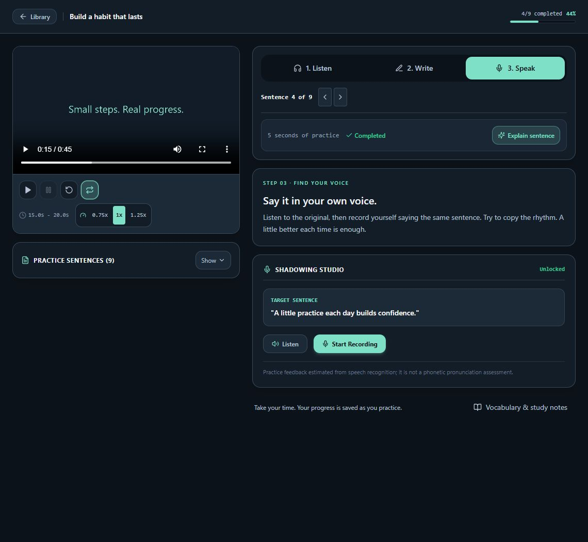

# FluentTube AI

Una app para practicar inglés con videos: **escucha una frase, escribe lo que oyes y practica decirla**. Incluye biblioteca, progreso guardado, dictado, grabación y explicaciones opcionales con IA.

[English / documentación principal](README.md) · [Arquitectura](README.md#architecture) · [Respaldo y publicación](docs/PUBLISHING.md)

## Capturas

Pantallas reales de la app con contenido ficticio, capturadas en una biblioteca de demostración separada.

| Tu biblioteca | Dictado y feedback |
| :---: | :---: |
| [](docs/assets/screenshots/library.jpg) | [](docs/assets/screenshots/dictation.jpg) |

*Haz clic en una imagen para verla en tamaño completo.*

<details>
<summary><strong>Ver la pantalla de práctica oral</strong></summary>



</details>

## Instalación en Windows

Necesitas **Python 3.11**, **Node.js 22 o superior**, npm y **FFmpeg / ffprobe** disponibles en `PATH`. Las dependencias de Python incluyen componentes para NVIDIA y pueden ocupar bastante espacio; también puedes transcribir con CPU.

Abre PowerShell en la carpeta del proyecto y ejecuta:

```powershell
npm ci
npm --prefix frontend ci
py -3.11 -m venv backend/.venv
.\backend\.venv\Scripts\python.exe -m pip install -r backend/requirements-lock.txt
Copy-Item backend/.env.example backend/.env
npm run dev
```

Copia el archivo de configuración solo durante la primera instalación. Después basta con `npm run dev`. Abre **[http://127.0.0.1:5173](http://127.0.0.1:5173)** y detén la app con **Ctrl+C**.

## Cómo practicar

1. En **Import Video → Video file**, elige un MP4 o WebM con voz clara en inglés.
2. Espera la transcripción. El primer uso puede descargar el modelo de voz.
3. Recorre **Listen**, **Write** y **Speak** a tu ritmo.

El límite inicial es **60 minutos / 250 MiB**. Puedes buscar videos, filtrar los completados, retomar una práctica o quitar un video con **Remove**. La eliminación pide confirmación y borra el progreso y las copias que guarda la app.

La transcripción de archivos se hace en tu computadora. Las importaciones largas guardan avances por partes para poder continuar después de un reinicio. Los enlaces de YouTube dependen de las restricciones de ese servicio; también puedes usar un archivo local.

## Configuración y privacidad

Las opciones están en `backend/.env`. La app funciona sin claves de IA. Para activar el tutor de Gemini, configura `GEMINI_API_KEY`, el modelo y `TUTOR_ENABLED=true`. Las funciones externas, como el tutor, diccionario y voz de referencia, pueden necesitar conexión y enviar texto al servicio correspondiente.

**No subas `.env`, cookies, bases de datos, grabaciones ni videos a GitHub.** Están excluidos por `.gitignore`; solo se publica la plantilla `.env.example` sin credenciales.

GitHub respalda el código. Para conservar tu biblioteca y progreso, detén la app y respalda por separado `backend/data/fluenttube.db` y `backend/media_cache/` si utilizas las rutas predeterminadas. Los borradores sin enviar y preferencias del navegador se guardan por separado.

## Comprobaciones

```powershell
npm run test:backend
npm run test:frontend
npm run build
npm run check-env
.\backend\.venv\Scripts\python.exe scripts/check_secrets.py --history
```

La revisión de credenciales reconoce formatos comunes sin mostrar sus valores. Es una ayuda para revisar lo que se publicará, no una garantía absoluta.

## Alcance

Es un proyecto personal y de portfolio para uso local. El feedback de voz estima palabras reconocidas y ritmo; no es una evaluación fonética de pronunciación. No incluye autenticación para alojarlo como servicio público. No se ha concedido una licencia de código abierto; consulta al propietario antes de reutilizar o redistribuir el código.
