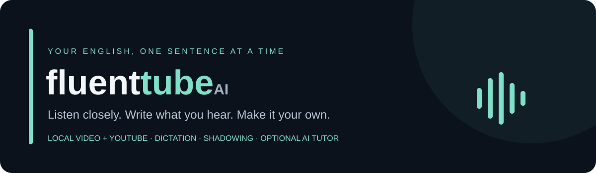
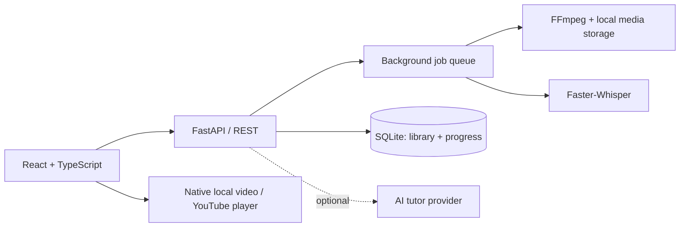

<div align="center">



**A local-first English practice app built around videos you care about.**

React · TypeScript · FastAPI · SQLite · Faster-Whisper

[Español](README.es.md) · [Screenshots](#screenshots) · [Getting started](#getting-started) · [Architecture](#architecture) · [Documentation](docs/README.md)

</div>

## What it does

FluentTube turns English speech into short exercises. Import a video, listen to one sentence, write what you hear, then practice saying it aloud. Your library and progress stay on your computer.

- **Bring your own video:** import MP4 or WebM files, with local transcription and native playback.
- **YouTube imports:** use English subtitles where available, with speech recognition as a fallback. Access depends on YouTube's restrictions.
- **A focused practice flow:** Listen → Write → Speak, with replay, speed controls and sentence looping.
- **Dictation feedback:** word alignment, hints, answer reveal and saved drafts.
- **Speaking practice:** record a short response and compare recognized words and timing.
- **A personal library:** search, filters, progress, resume, review completed videos and remove unwanted videos with confirmation.
- **Optional AI assistance:** contextual grammar and vocabulary explanations when a tutor provider is configured.
- **Recoverable imports:** long local transcriptions save completed five-minute parts and can resume after a restart.

## Screenshots

Real app screenshots captured with synthetic demo content in an isolated library.

| Your library | Dictation feedback |
| :---: | :---: |
| [](docs/assets/screenshots/library.jpg) | [](docs/assets/screenshots/dictation.jpg) |

*Click an image to view it at full size.*

<details>
<summary><strong>See the speaking workspace</strong></summary>


</details>

## Getting started

The root launcher commands target **Windows PowerShell**. Python 3.11, Node.js 22 or newer, npm, and both `ffmpeg` and `ffprobe` on `PATH` are required. CPU transcription is supported; NVIDIA acceleration is optional. The pinned backend dependencies include NVIDIA runtime packages and can require a substantial download.

Run these commands from the project root after cloning:

```powershell
# Install JavaScript dependencies
npm ci
npm --prefix frontend ci

# Create the Python environment and install the pinned dependencies
py -3.11 -m venv backend/.venv
.\backend\.venv\Scripts\python.exe -m pip install -r backend/requirements-lock.txt

# Create your PRIVATE local configuration (only on first setup)
Copy-Item backend/.env.example backend/.env

# Start the API and browser app
npm run dev
```

Open **[http://127.0.0.1:5173](http://127.0.0.1:5173)**. Press **Ctrl+C** in the terminal to stop it.

On later visits, just run `npm run dev`. To start the two services separately, run `npm run dev:backend` and `npm run dev:frontend` in separate terminals. Backend reload is opt-in (`npm run dev:backend:reload`); avoid it during imports.

For macOS/Linux, create `backend/.venv` with `python3.11 -m venv`, install the same dependencies using `backend/.venv/bin/python`, and start the API with:

```sh
backend/.venv/bin/python -m uvicorn backend.app.main:app --host 127.0.0.1 --port 8000
```

Run `npm run dev:frontend` separately. The Windows root launcher is not portable; other operating systems have not been validated here.

### First practice session

1. Choose **Import Video → Video file**.
2. Select an MP4 (H.264 recommended) or WebM with clear English speech, up to **250 MiB / 60 minutes** by default.
3. Wait for transcription, then work through **Listen**, **Write** and **Speak**.

The first transcription may download a speech model. Once cached, local imports and local playback do not require YouTube. Fragmented MP4 files get a cached playback copy without re-encoding; the app preserves its original copy and may use extra disk space.

## Configuration and privacy

Copy `backend/.env.example` to `backend/.env` and keep real credentials there. The example contains empty credential fields; `.env` files, session cookies, media, databases, logs and model downloads are excluded from Git.

| Setting | Purpose |
| --- | --- |
| `SPEECH_DEVICE` | `auto`, `cpu` or `cuda` |
| `SPEECH_MODEL` / `SPEECH_CPU_MODEL` | Speech models for the selected device / CPU fallback |
| `MAX_VIDEO_SECONDS` | Maximum input duration; default 3600 seconds |
| `MAX_SOURCE_AUDIO_BYTES` | Upload size limit; default 250 MiB |
| `TUTOR_ENABLED` | Enable optional explanations; false in the example configuration |
| `GEMINI_API_KEY` | Optional credential for the Gemini tutor |
| `TUTOR_MODEL` | Provider model name; availability depends on your account |

You can practice without an API key. When used, cloud tutor features send sentence context or vocabulary text to the configured provider. Dictionary and reference speech features can also contact external services. Local video transcription runs on your computer.

The API binds to `127.0.0.1:8000`; this is a single-user local application, not an authenticated public hosting service. API documentation is available at [localhost:8000/api/docs](http://127.0.0.1:8000/api/docs) while running.

## Architecture



The frontend uses TanStack Query for server state, Zustand for practice state, and Tailwind CSS for the interface. The backend owns scoring and persistence. SQLite uses WAL mode and foreign keys. Long imports run in a bounded worker queue, with checkpoints for local transcription.

```text
backend/
  app/routers/       HTTP endpoints
  app/services/      Import, speech recognition, alignment and tutor logic
  tests/             Backend tests
  .env.example       Safe configuration template
frontend/
  src/components/    Practice interface and controls
  src/pages/         Library, study workspace and settings
  src/player/        Local and YouTube playback adapters
  src/stores/        Practice state and preferences
  tests/             Frontend tests
shared/              Normalization rules and test fixtures
docs/                Architecture, design records and repository guides
scripts/             Local launchers and credential checks
```

## Development checks

```powershell
npm run test:frontend
npm run test:backend
npm run build
npm run check-env
.\backend\.venv\Scripts\python.exe scripts/check_secrets.py --history
```

Backend tests use isolated storage. Live YouTube tests are skipped unless explicitly enabled with `--live-youtube`; the normal suite does not initiate live YouTube imports. The credential check looks for common key formats and private files without printing values; it is a supplementary check, not a guarantee that every possible secret is detected.

## Practical limits

- YouTube can reject anonymous imports or require verification. The app spaces imports and pauses after access restrictions; it cannot guarantee availability. Import a local file when needed.
- Speaking feedback estimates recognized words and timing. It is not a phonetic pronunciation assessment.
- CPU transcription can take time. GPU support depends on compatible NVIDIA hardware, drivers and the installed runtime.
- Browser drafts and preferences are stored separately from the SQLite library.
- Removing a video permanently removes its practice history and the app's stored local copies after confirmation.

## Backup and publishing

GitHub backs up the **source code**, not your videos or personal progress. See [backup and publishing](docs/PUBLISHING.md) for the pre-push checklist and local data backup instructions, and [security](SECURITY.md) for credential handling.

## Project status and license

This is a portfolio and personal learning project under active development. Historical specifications and validation notes are kept in `docs/`; they describe decisions at the time and may differ from current behavior.

No open-source license has been granted. The source is available for review; contact the repository owner for permission to reuse or redistribute it. Third-party dependencies retain their own licenses.
